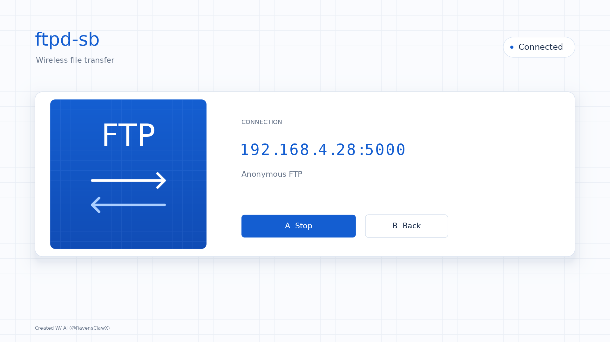

# ftpd-sb

**FTP file transfer for romfs, save, and tmp.**

A homebrew FTP server for SmileBASIC, built with the
[HBLauncher SDK](https://github.com/ravensclawx/HBLauncher). Open it on your
console and connect from a PC with FileZilla or another FTP client.

> **USE AT YOUR OWN RISK.** This software is provided as-is, without warranties.
> To the fullest extent permitted by law, RavensClawX and contributors are not
> responsible for damage to your Nintendo Switch 2, PC, Pico, or other hardware;
> data loss; corrupted saves; or other consequences of using this software.
> Back up important data before making changes. FTP writes and deletes affect
> real SmileBASIC files.



Maintained by **RavensClawX**. Version **0.1.0**.

## Install

1. Install or update to [HBLauncher v0.2.0](https://github.com/ravensclawx/HBLauncher/releases/tag/v0.2.0)
   or newer. The older initial launcher does not include the FTP service.
   Follow its [setup guide](https://github.com/ravensclawx/HBLauncher/blob/main/docs/GETTING_STARTED.md)
   for SmileBASIC, the Pico and the PC host.
2. Download **ftpd-sb-v0.1.0.zip** from [Releases](https://github.com/ravensclawx/ftpd-sb/releases/latest).
3. Extract its `ftpd-sb` folder into the host PC's `HBLauncher/apps/` directory:
   ```text
   HBLauncher/
     apps/
       ftpd-sb/
         app.json
         app.vert.spv
         app.frag.spv
         app.comp.spv
         assets/
         ...
   ```
4. Start the updated HBLauncher host. In the launcher, select **Refresh**, then
   open **ftpd-sb**. No app compilation or files on the Pico/console SD card are
   needed for this prebuilt package.
5. Press **A** or tap **Start**. The app displays the console's IP address and port.

The supported environment is the same as HBLauncher: **SmileBASIC 4.4.9 on
Switch 2 firmware 23.0.1**, with the Pico bootstrap already configured. This is
an HBLauncher GPU app, not an NRO for a conventional custom-firmware launcher.
The PC host must remain running throughout the session.

## Connect with FileZilla

Create a Site Manager entry with these settings:

| Setting | Value |
| --- | --- |
| Protocol | FTP |
| Host | The console IP displayed by ftpd-sb |
| Port | `5000` (or the port displayed) |
| Encryption | Only use plain FTP |
| Logon type | Anonymous |
| Transfer mode | Passive |
| Maximum simultaneous connections | **1** |

Click **Connect**. The left pane shows PC files; the right pane shows console
files. Drag between them to upload/download. Right-click files and folders to
rename, delete or create directories. With other clients, use username
`anonymous` and any password. Plain FTP is unencrypted and anonymous: use it on
a trusted local network, not through public port forwarding.

## Controls

- **A / Start or Stop button:** start or stop the FTP server.
- **B / Minus / Back button:** return to HBLauncher and close FTP connections.
- The status badge shows whether the server is stopped, ready, connected or
  transferring. The arrows animate while data is moving.

## What you can access

| FTP folder | Console storage | Access |
| --- | --- | --- |
| `/save` | SmileBASIC's save files | Read/write |
| `/tmp` | SmileBASIC's temporary files | Read/write |
| `/rom` | SmileBASIC romfs | Read-only |

This does not expose the SD card, other games' saves, or the host PC filesystem.
The title's SD filesystem request is denied on the tested environment. Save
files are real SmileBASIC data: keep a backup before replacing or deleting them.
Temporary storage is not a durable backup location.

Uploads, appends, downloads, resumed downloads, directory listing, folder
creation, rename and deletion are supported. Successful writes are flushed and
committed before completion is reported. Overwriting an existing file replaces
it directly; disconnects or stopping midway can leave a partial file. Wait for
transfers to finish before stopping the app or closing the host.

Version 0.1.0 supports one client at a time, IPv4 and passive transfers. It does
not implement encrypted FTP, upload resume, timestamps, recursive directory
delete, or cross-mount rename. Directory listings are limited to 4096 entries.
The host's wireless debugging bridge limits transfer speed; it is not a native
standalone CPU executable or a replacement for full SD-access homebrew.

## Update or remove

Return to HBLauncher first. Replace `apps/ftpd-sb/` with the newer package and
select Refresh to update. Delete that folder and Refresh to remove the app.
App-only updates can be loaded without restarting SmileBASIC. If the release
requires a newer host/SDK, update the host and start a fresh SmileBASIC session.

## Troubleshooting

- **Starting... never changes:** update HBLauncher to v0.2.0 or newer and restart
  the host. Its terminal should say `SDK FTP service ready.`
- **Could not start server:** check the host's private session
  `ftp-service.json` for the error. Another server may already own port 5000.
- **FileZilla connects but transfers hang:** set the site's maximum simultaneous
  connections to **1** and disconnect other clients. Use passive mode.
- **Connection refused:** press A to start the server; use the console IP on
  screen, not the PC/Pico IP. Keep devices on the same reachable LAN.
- **A write fails:** `/rom` is read-only. Save capacity, invalid paths, missing
  parent folders, or existing rename destinations can also reject an operation.
- **A transfer disconnects:** retry on a stable LAN. Downloads support resume;
  restart incomplete uploads or use append only when you know the correct size.

## Build from source

Install the tools described in HBLauncher's SDK guide (Node.js 22+, Python with
Pillow, DejaVu fonts, glslangValidator and spirv-val). Then:

```sh
node build.cjs /absolute/path/to/HBLauncher
node check.cjs /absolute/path/to/HBLauncher
```

Alternatively set `HBLAUNCHER_ROOT` to that directory. Build copies the SDK
headers, rasterizes the text/icon, creates initial state, and compiles/validates
all three shaders. The prebuilt assets are checked in, so users do not need the
build tools merely to install the app.

The app declares `sdk.services: ["ftp"]` in `app.json`. Its compute shader sends
start/stop requests through `hbFtpCommand()`; its fragment shader reads the
`hbFtp*` status helpers. The SDK owns the actual console sockets, native file
handles, protocol processing and commit lifecycle. No arbitrary host script is
loaded from the app package. See the
[SDK FTP documentation](https://github.com/ravensclawx/HBLauncher/blob/main/sdk/docs/ftp.md)
for the full manifest, protocol and memory layout.

## Validation and credits

Tested live with console TCP echo and isolated read/write/rename/delete/commit
checks on both writable mounts. Python ftplib completed upload/download,
overwrite, append, resumed retrieval, MLSD, rename and delete round trips;
FileZilla connected and browsed the console. UI shaders were rendered on desktop
Vulkan and loaded into the live launcher. SDK regression tests cover path
boundaries, ROM write rejection, peer matching, partial sends, authentication,
transfer cleanup and long-transfer idle handling.

Built with the HBLauncher SDK, whose entry path credits
[pepsipu/ns2jb](https://gitlab.com/pepsipu/ns2jb). Text is rasterized from DejaVu
Sans and DejaVu Sans Mono. This is an independent project, not affiliated with
Nintendo, SmileBoom, FileZilla or the original ftpd project. No blanket license
has been assigned to this package; third-party components retain their terms.
